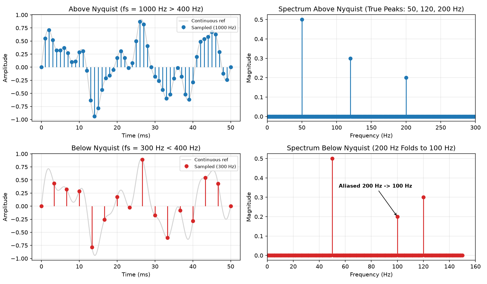
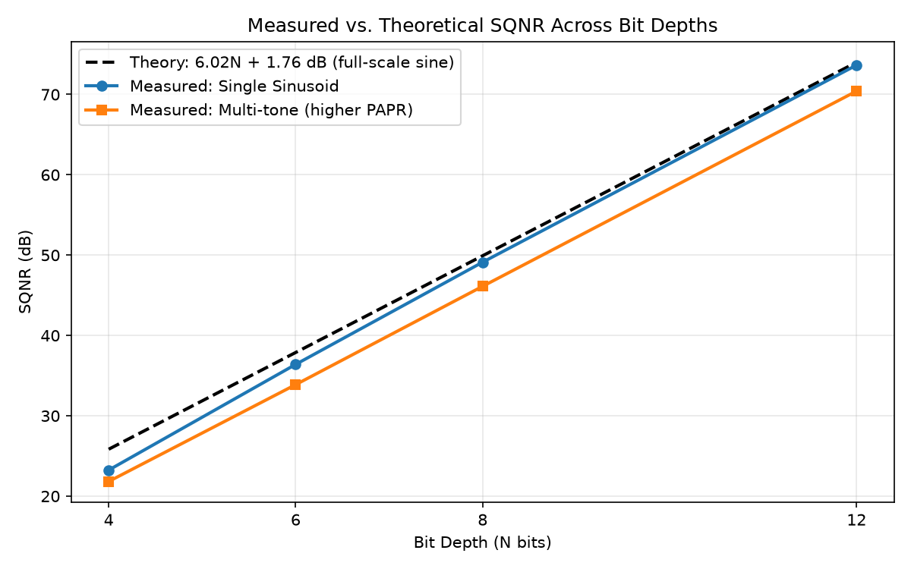
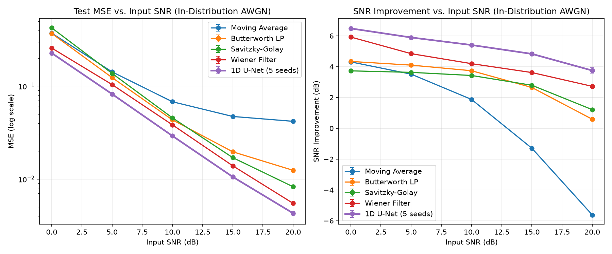
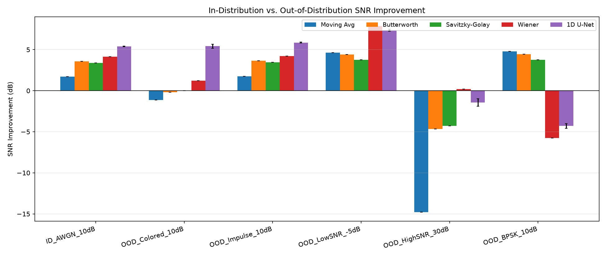
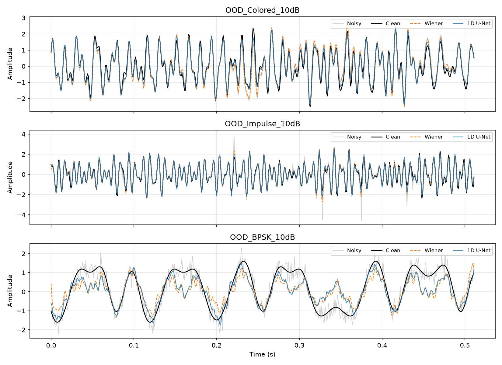
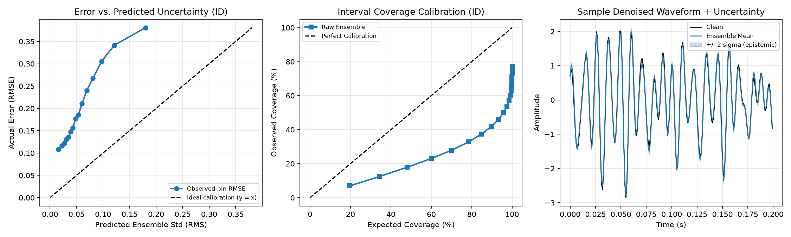

# Noise-Robust Signal Denoising: Classical Filters vs. a Learned Denoiser, with Uncertainty Estimation

A reproducible signal processing and machine learning benchmark comparing classical DSP filters against a lightweight 1D convolutional U-Net across in-distribution AWGN, out-of-distribution (OOD) corruptions, unseen signal families, and Deep Ensemble uncertainty calibration.

---

## 1. Repository Structure

```text
signal_project/
├── matlab/
│   ├── part1_sampling_quantization.m   # MATLAB script for aliasing & SQNR
│   └── part3_classical_filtering.m     # MATLAB companion for classical filtering (5 dB AWGN)
├── scripts/
│   ├── run_part1.py                    # Part 1: Sampling, aliasing, and quantization
│   ├── check_part2.py                  # Part 2: Synthetic signal family visualization
│   ├── run_part3.py                    # Part 3: Validation-only tuning of classical filters
│   ├── run_part4_train.py              # Part 4: 5-seed 1D U-Net training & ID evaluation
│   ├── run_part5_ood.py                # Part 5: OOD noise, SNR, and signal-family stress tests
│   └── run_part6_uncertainty.py        # Part 6: 5-member Deep Ensemble uncertainty & calibration
├── src/
│   ├── utils.py                        # Seed fixing, MSE, SNR, and SNR improvement
│   ├── data_gen.py                     # Signal families (sin_chirp, BPSK) & noise models
│   ├── classical_filters.py            # Moving Avg, Butterworth, Savitzky-Golay, Wiener
│   └── model.py                        # 3-level residual 1D U-Net (129,425 parameters)
├── tests/
│   └── test_sanity.py                  # Pytest unit tests (SNR math, leakage, filter preservation)
├── results/
│   ├── figures/                        # Saved plots for Parts 1–6
│   ├── tables/                         # Saved CSV metric tables for Parts 4–6
│   └── models/                         # Saved 5-seed PyTorch checkpoints
├── requirements.txt
└── README.md
```

---

## 2. Method Summary & Experimental Setup

### Part 1: Sampling, Aliasing, and Quantization
* **Signal:** Multi-tone test signal $x(t) = 0.5\sin(2\pi \cdot 50t) + 0.3\sin(2\pi \cdot 120t) + 0.2\sin(2\pi \cdot 200t)$ ($f_{\max} = 200\text{ Hz}$, Nyquist rate $= 400\text{ Hz}$).
* **Aliasing:** Sampled above Nyquist ($f_s = 1000\text{ Hz}$) and below Nyquist ($f_s = 300\text{ Hz}$, folding the $200\text{ Hz}$ tone to $\vert{}300 - 200\vert{} = 100\text{ Hz}$).
* **Quantization:** Uniform mid-tread quantizer over $[-1, 1]$ at $N \in \{4, 6, 8, 12\}$ bits, compared against the theoretical full-scale sinusoid rule $\text{SQNR} \approx 6.02N + 1.76\text{ dB}$.

### Part 2: Synthetic Data & Leakage Prevention
* **Sampling & Length:** $N = 512$ samples at $f_s = 1000\text{ Hz}$, normalized to unit RMS power.
* **Signal Families:**
  * `sin_chirp` (used for training): Sum of 2–4 random sinusoids ($20\text{–}180\text{ Hz}$) plus a linear chirp ($25\text{–}80\text{ Hz} \to 120\text{–}220\text{ Hz}$).
  * `bpsk` (held out for OOD testing): Random $\pm 1$ BPSK symbols pulse-shaped with a Raised-Cosine filter ($\text{sps}=16$, $\beta=0.35$).
* **Splits (isolated RNG seeds, zero leakage):**
  * Train: 2,000 `sin_chirp` signals, AWGN uniformly sampled in $[0, 20]\text{ dB}$ (`seed=1001`).
  * Validation: 400 `sin_chirp` signals, AWGN in $[0, 20]\text{ dB}$ (`seed=2001`).
  * Test: 200 unseen signals per SNR / OOD scenario (`seeds=3000–6004`).

### Part 3: Classical Baselines (Tuned on Validation Set Only)
* **Moving Average:** Zero-phase symmetric boxcar (`uniform_filter1d`). Best val: `window=3`.
* **Butterworth Low-Pass:** Zero-phase IIR (`butter` + `filtfilt`). Best val: `cutoff_hz=190.0, order=6`.
* **Savitzky-Golay:** Local polynomial least-squares filter. Best val: `window=9, polyorder=4`.
* **Frequency-Domain Wiener Filter:** $H(f) = \frac{\hat{S}_{xx}(f)}{\hat{S}_{xx}(f) + \alpha \hat{S}_{nn}}$, where $\hat{S}_{xx}(f)$ is the average clean training PSD and $\hat{S}_{nn}$ is estimated per signal from the out-of-band $[350, 500]\text{ Hz}$ spectrum. Best val: `alpha=1.0`.

### Part 4: Learned Denoiser (1D U-Net)
* **Architecture:** 3-level residual 1D U-Net (`base_ch=16`, **129,425 parameters**) predicting a residual correction $\hat{x} = y + f_\theta(y)$.
* **Training:** MSE loss, Adam (`lr=2e-3`) with cosine annealing over 25 epochs, batch size 64, selecting the best validation checkpoint per seed across **5 independent seeds (`0–4`)**. Total CPU training time: ~6.2 minutes (~70–80 s/seed).

### Part 5 & Part 6: OOD Stress Tests & Deep Ensemble Uncertainty
* **OOD Suite:** Colored noise ($1/f^{1.5}$ at $10\text{ dB}$), impulsive Bernoulli-Gaussian noise ($10\text{ dB}$), extrapolated SNRs ($-5\text{ dB}$ and $30\text{ dB}$), and unseen `bpsk` family ($10\text{ dB}$ AWGN).
* **Uncertainty:** The 5 independently trained U-Net checkpoints form a **5-member Deep Ensemble** with predictive mean $\mu(t)$ and epistemic standard deviation $\sigma(t)$ (`ddof=1`).

---

## 3. Experimental Results

### Part 1: Quantization SQNR (dB)
| Bit Depth ($N$) | Theory ($6.02N + 1.76$) | Measured Single Sine | Measured Multi-Tone |
|---:|---:|---:|---:|
| 4 | 25.84 | 23.24 | 21.83 |
| 6 | 37.88 | 36.40 | 33.88 |
| 8 | 49.92 | 49.12 | 46.12 |
| 12 | 74.00 | 73.65 | 70.41 |

*Single-tone SQNR converges to the theoretical rule (73.65 vs. 74.00 dB at 12 bits). Multi-tone SQNR sits ~3.5 dB lower due to its higher Peak-to-Average Power Ratio (PAPR). MATLAB R2018b reproduces all values identically.*




### Part 3: Validation-Tuned Classical Baselines (`sin_chirp`, AWGN 0–20 dB)
| Method | Best Validation Params | Val MSE | Val SNR Imp (dB) |
|---|---|---:|---:|
| Moving Average | `window=3` | 0.10016 | +0.71 |
| Butterworth LP | `cutoff_hz=190.0, order=6` | 0.07588 | +3.27 |
| Savitzky-Golay | `window=9, polyorder=4` | 0.08247 | +3.13 |
| Wiener Filter | `alpha=1.0` | **0.05938** | **+4.17** |

### Part 4: In-Distribution Test Performance vs. Input SNR (`sin_chirp`, AWGN)
Values report Test MSE and SNR Improvement (dB); 1D U-Net shows **mean ± std over 5 seeds**.

| Input SNR | Moving Avg | Butterworth | Savitzky-Golay | Wiener | 1D U-Net (5 seeds) |
|---:|---|---|---|---|---|
| **0 dB** | 0.37233 (+4.31 dB) | 0.36979 (+4.34 dB) | 0.42488 (+3.73 dB) | 0.25755 (+5.92 dB) | **0.22730 ± 0.00209 (+6.48 ± 0.04 dB)** |
| **5 dB** | 0.14267 (+3.51 dB) | 0.12384 (+4.10 dB) | 0.13740 (+3.63 dB) | 0.10415 (+4.84 dB) | **0.08237 ± 0.00053 (+5.89 ± 0.03 dB)** |
| **10 dB** | 0.06802 (+1.87 dB) | 0.04342 (+3.74 dB) | 0.04565 (+3.43 dB) | 0.03838 (+4.19 dB) | **0.02917 ± 0.00031 (+5.41 ± 0.05 dB)** |
| **15 dB** | 0.04722 (-1.30 dB) | 0.01967 (+2.65 dB) | 0.01702 (+2.79 dB) | 0.01390 (+3.62 dB) | **0.01056 ± 0.00020 (+4.83 ± 0.08 dB)** |
| **20 dB** | 0.04188 (-5.62 dB) | 0.01243 (+0.59 dB) | 0.00827 (+1.21 dB) | 0.00548 (+2.72 dB) | **0.00429 ± 0.00017 (+3.75 ± 0.17 dB)** |



### Part 5: Out-of-Distribution (OOD) Robustness (SNR Improvement in dB)
| Scenario | Moving Avg | Butterworth | Savitzky-Golay | Wiener | 1D U-Net (5 seeds) |
|---|---:|---:|---:|---:|---:|
| `ID_AWGN_10dB` (ref) | +1.70 | +3.58 | +3.38 | +4.14 | **+5.40 ± 0.04** |
| `OOD_Colored_10dB` ($1/f^{1.5}$) | -1.14 | -0.17 | -0.01 | +1.22 | **+5.43 ± 0.24** |
| `OOD_Impulse_10dB` | +1.76 | +3.65 | +3.44 | +4.20 | **+5.86 ± 0.05** |
| `OOD_LowSNR_-5dB` | +4.62 | +4.42 | +3.76 | **+7.85** | +7.37 ± 0.12 |
| `OOD_HighSNR_30dB` | -14.77 | -4.65 | -4.28 | **+0.19** | -1.44 ± 0.46 |
| `OOD_BPSK_10dB` (unseen family) | **+4.77** | +4.46 | +3.77 | -5.75 | -4.29 ± 0.29 |

**Key Takeaways:**
* **Where 1D U-Net wins:** In-distribution AWGN, colored $1/f^{1.5}$ noise (where low-frequency noise passes straight through linear low-pass filters), and impulsive noise (where nonlinear convolutions suppress sparse spikes better than LTI filters).
* **Where 1D U-Net fails:**
  1. **Unseen signal family (`OOD_BPSK_10dB`):** Both Wiener (-5.75 dB) and 1D U-Net (-4.29 dB) degrade the signal because their learned/estimated priors match `sin_chirp` (20–220 Hz) rather than low-frequency BPSK baseband energy. Signal-agnostic smoothers (Moving Average +4.77 dB, Butterworth +4.46 dB) generalize cleanly.
  2. **Extrapolated SNR (`-5 dB` and `30 dB`):** Wiener adapts per signal via its out-of-band noise estimate ($H(f) \to 1$ at 30 dB), whereas the single U-Net suffers from out-of-range noise amplitudes at -5 dB and a learned residual bias floor at 30 dB.




### Part 6: Deep Ensemble ($K=5$) Uncertainty & Calibration
| Scenario | Ens. MSE | SNR Imp (dB) | RMSE / $\sigma$ | Pointwise Spearman $r$ | Signal-Level Spearman $r$ | $\pm 1\sigma$ Cov (68.3%) | $\pm 2\sigma$ Cov (95.4%) |
|---|---:|---:|---:|---:|---:|---:|---:|
| `ID_AWGN_0_20dB` | 0.04779 | +5.70 | 2.92x | 0.393 | **0.979** | 27.1% | 49.4% |
| `OOD_LowSNR_-5dB` | 0.52969 | +7.79 | 2.73x | 0.005 | 0.130 | 26.6% | 49.1% |
| `OOD_Impulse_10dB` | 0.02505 | +6.08 | 2.98x | 0.189 | 0.249 | 27.9% | 51.3% |
| `OOD_BPSK_10dB` | 0.26216 | -4.02 | 4.73x | 0.428 | 0.660 | 13.6% | 28.7% |

**Honest Calibration Assessment:**
* **Strong relative ranking (ID):** Signal-level uncertainty tracks actual signal RMSE closely in-distribution (Spearman $r = 0.979$, Pearson $r = 0.974$), and ensembling improves denoising accuracy over single seeds (e.g., `+7.79 dB` vs. `+7.37 dB` at `-5 dB`).
* **Poor raw calibration (overconfidence):** Predicted $\sigma$ is ~2.9x smaller than actual RMSE in-distribution ($\pm 2\sigma$ coverage is 49.4% instead of 95.4%) and worsens to 4.73x under BPSK shift (13.6% at $\pm 1\sigma$). This is expected because an MSE-trained ensemble captures **epistemic** disagreement across seeds but omits **aleatoric** noise variance. Under severe noise (`-5 dB`), pointwise uncertainty correlation collapses ($r = 0.005$).



---

## 4. Limitations & Future Work
1. **Epistemic-only uncertainty:** Training with a heteroscedastic Gaussian negative log-likelihood (predicting both $\mu(t)$ and $\sigma_{\text{aleatoric}}^2(t)$) or applying validation-set conformal / variance scaling would directly fix the ~2.9x under-dispersion.
2. **Single-family training prior:** Training jointly on diverse signal families (or conditioning on an estimated noise PSD) would mitigate the BPSK and high-SNR failure modes.
3. **Wiener noise-floor assumption:** Estimating $\hat{S}_{nn}$ from $[350, 500]\text{ Hz}$ assumes white noise and a bandlimited signal below $350\text{ Hz}$; it breaks under colored noise.

---

## 5. How to Reproduce

```bash
# 1. Install dependencies
pip install -r requirements.txt

# 2. Run sanity-check unit tests
python -m pytest -v

# 3. Reproduce all parts and figures
python scripts/run_part1.py             # -> part1_aliasing.png, part1_quantization_sqnr.png
python -m scripts.check_part2           # -> part2_sample_signals.png
python -m scripts.run_part3             # -> classical_params.json, clean_psd.npy
python -m scripts.run_part4_train       # -> part4_in_distribution.csv, part4_snr_curves.png
python -m scripts.run_part5_ood         # -> part5_ood_robustness.csv, part5_ood_comparison.png, part5_ood_waveforms.png
python -m scripts.run_part6_uncertainty # -> part6_uncertainty_metrics.csv, part6_uncertainty_calibration.png
```

For the MATLAB portion (tested in MATLAB R2018b), run from `matlab/`:
* `part1_sampling_quantization` — reproduces Python SQNR values identically and saves `part1_aliasing_matlab.png` and `part1_quantization_sqnr_matlab.png`.
* `part3_classical_filtering` — 5 dB AWGN multi-tone demo (Moving Avg and Butterworth LP both achieve +3.69 dB SNR improvement) and saves `part3_filtering_matlab.png`.